# MeshCentral Inventory

Inventory and lifecycle management for MeshCentral workstations and peripherals.

## Preview

<p align="center">
  <a href="./docs/screenshots/gallery/workstations-dashboard.png">
    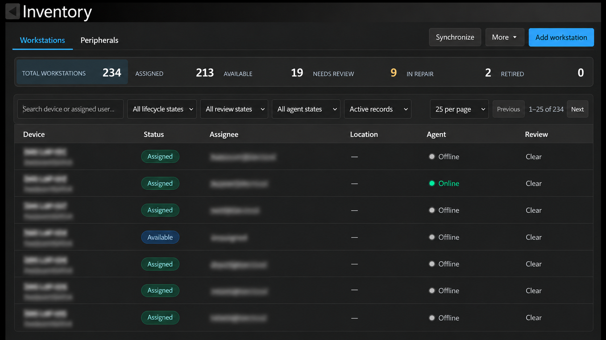
  </a>
</p>

<p align="center"><sub>Live workstation inventory with lifecycle totals, filters, assignment, connectivity, and review state. Production identifiers are redacted.</sub></p>

### Screenshot tour

Swipe or scroll horizontally to browse. Select any screenshot to open it full size.

<table>
  <tr>
    <td width="760" valign="top">
      <a href="./docs/screenshots/gallery/workstations-review-filter.png">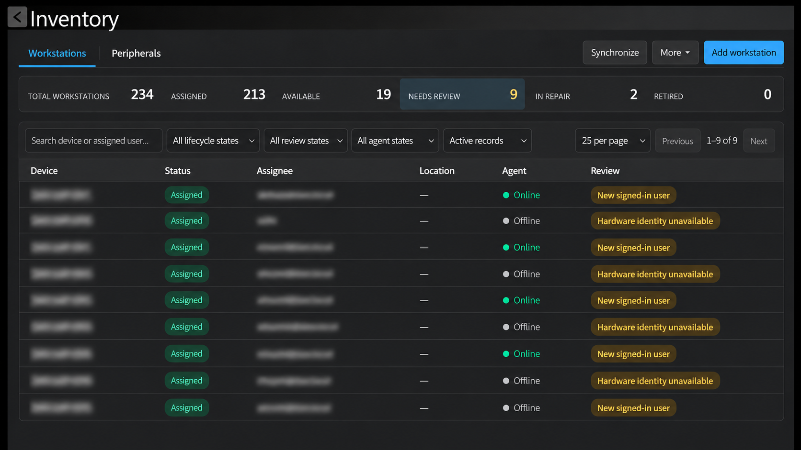</a><br>
      <sub><b>Review workflow</b><br>Filter devices that need administrator attention.</sub>
    </td>
    <td width="760" valign="top">
      <a href="./docs/screenshots/gallery/peripherals-dashboard.png">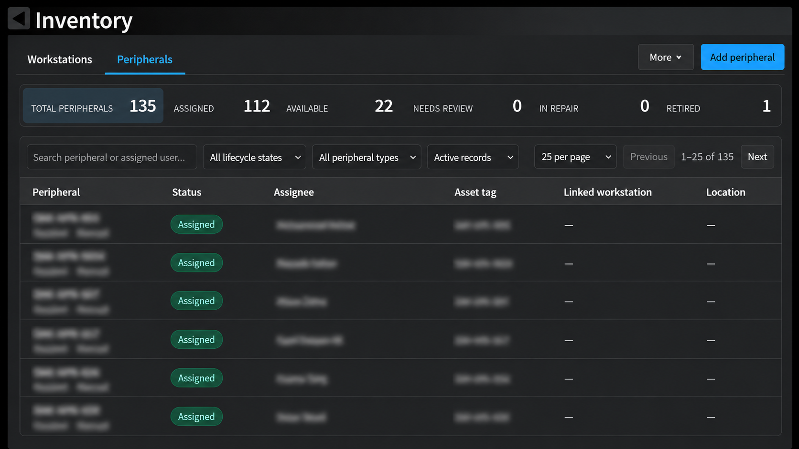</a><br>
      <sub><b>Peripheral inventory</b><br>Track manually managed peripherals and their assignments.</sub>
    </td>
    <td width="760" valign="top">
      <a href="./docs/screenshots/gallery/workstation-lifecycle-assignment.png">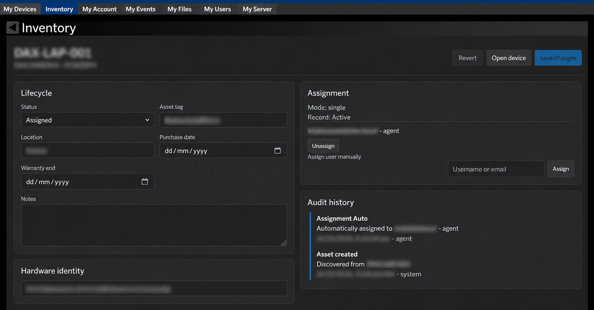</a><br>
      <sub><b>Lifecycle and assignment</b><br>Manage status, ownership, dates, location, and audit history.</sub>
    </td>
    <td width="760" valign="top">
      <a href="./docs/screenshots/gallery/workstation-hardware-identity.png">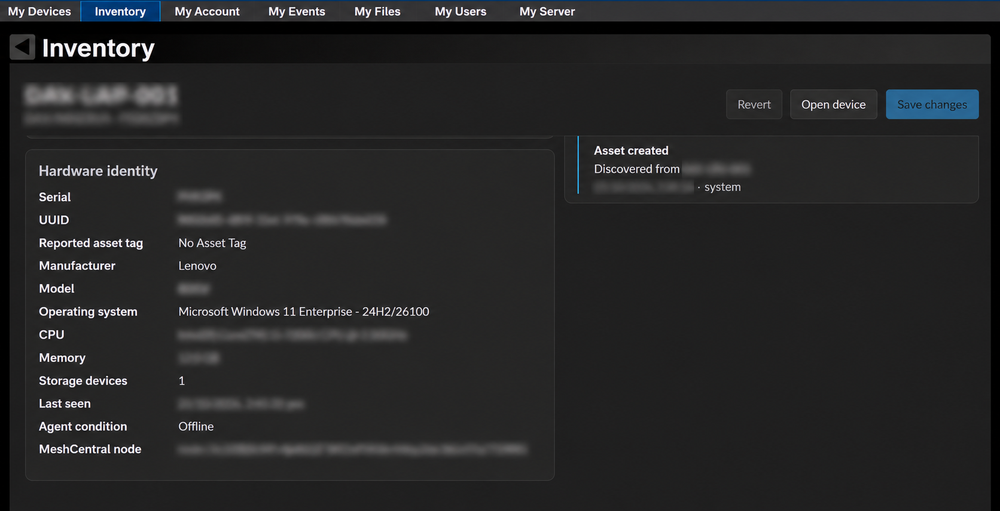</a><br>
      <sub><b>Hardware identity</b><br>Inspect serial, UUID, model, operating system, and agent state.</sub>
    </td>
    <td width="760" valign="top">
      <a href="./docs/screenshots/gallery/peripheral-lifecycle-assignment.png">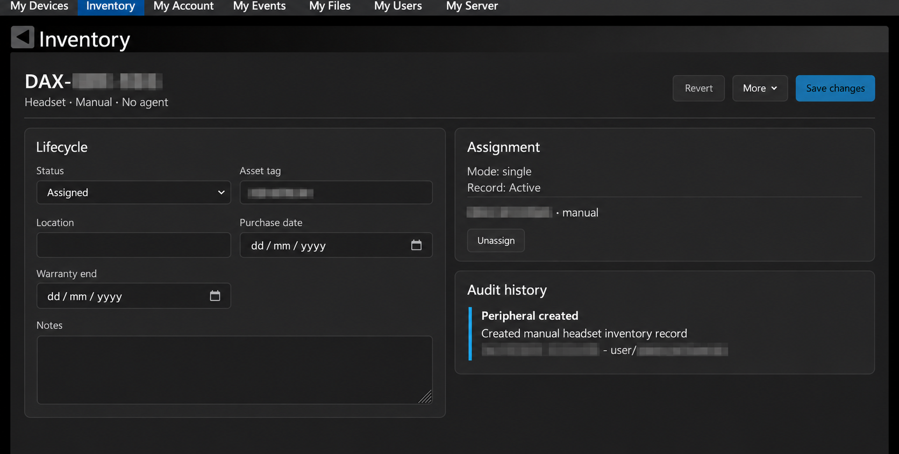</a><br>
      <sub><b>Peripheral lifecycle</b><br>Record manual assignment and retain a clear audit trail.</sub>
    </td>
    <td width="760" valign="top">
      <a href="./docs/screenshots/gallery/peripheral-linked-workstation.png">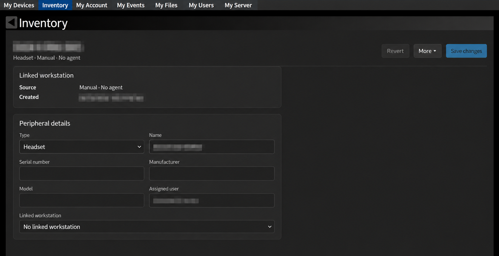</a><br>
      <sub><b>Workstation links</b><br>Associate a peripheral with its workstation when needed.</sub>
    </td>
    <td width="760" valign="top">
      <a href="./docs/screenshots/gallery/peripheral-actions-menu.png">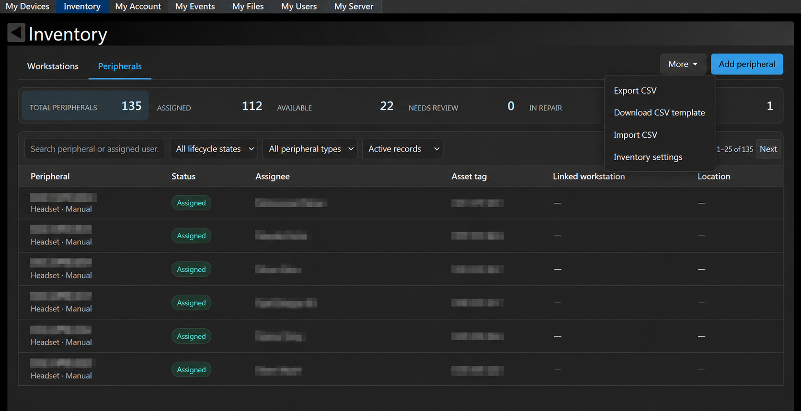</a><br>
      <sub><b>Inventory actions</b><br>Export, import, download templates, and open settings.</sub>
    </td>
    <td width="760" valign="top">
      <a href="./docs/screenshots/gallery/inventory-settings-policy.png">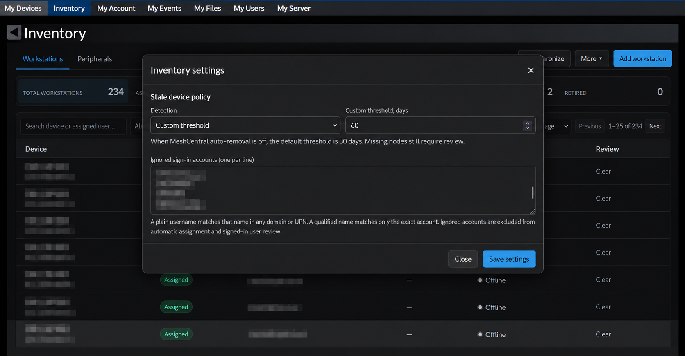</a><br>
      <sub><b>Inventory policy</b><br>Configure stale-device detection and ignored accounts.</sub>
    </td>
    <td width="760" valign="top">
      <a href="./docs/screenshots/gallery/inventory-backup-restore.png">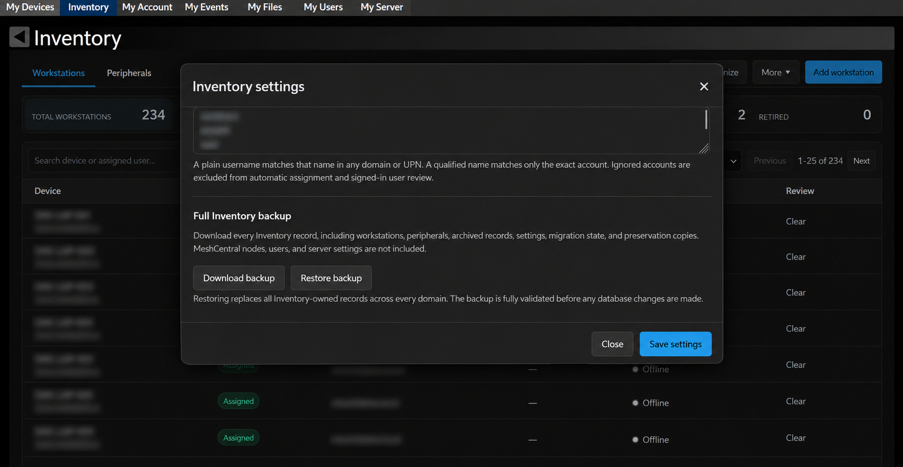</a><br>
      <sub><b>Backup and restore</b><br>Download or restore all Inventory-owned records.</sub>
    </td>
    <td width="760" valign="top">
      <a href="./docs/screenshots/gallery/plugin-installed.png">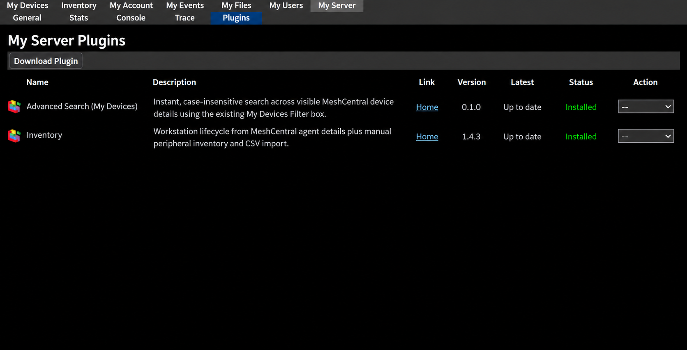</a><br>
      <sub><b>Native integration</b><br>Installed and updated through MeshCentral's plugin manager.</sub>
    </td>
  </tr>
</table>

## Features

- Automatically discovers agent-backed workstations.
- Tracks hardware identity by serial number and UUID.
- Shows live agent connectivity and linked MeshCentral records.
- Assigns the first reported user and sends later changes for review.
- Supports manual workstations and peripherals.
- Provides lifecycle states, notes, locations, purchase dates, and warranties.
- Detects missing, stale, duplicate, and conflicting records.
- Includes CSV peripheral import/export, permissions, and audit history.
- Downloads and restores a full, validated Inventory backup.

## How it works

- Hardware and user data come from MeshCentral node, system-information, and agent events. No extra endpoint collector is installed.
- Inventory records are stored in MeshCentral's configured database and remain separate from MeshCentral node records.
- Automatic workstations are matched by hardware identity, so replacing a MeshCentral node ID does not create a new physical asset.
- The plugin synchronizes once after startup, every six hours, when requested manually, and when relevant agent events arrive. It does not poll every second or minute.
- Permissions and device-group visibility are enforced on the server.

## Requirements

- MeshCentral 1.2.5 or later
- MeshCentral plugins enabled

## Install

1. Open **My Server → Plugins**.
2. Select **Download Plugin**.
3. Enter:

   ```text
   https://raw.githubusercontent.com/maxdorx/meshcentral-inventory/main/config.json
   ```

4. Install Inventory, refresh MeshCentral, and select **Synchronize** for the first scan.

## Permissions

- **View inventory** — view records within the user's MeshCentral scope.
- **Manage inventory** — edit lifecycle, assignments, reviews, and manual records.
- **Synchronize inventory** — run a full synchronization.

Permissions are configured from the Inventory entry under **My Server → Plugins**.

## Updates

Use **Upgrade** from the Inventory plugin row when MeshCentral reports a newer version. Updating plugin files does not delete inventory records. Full administrators can download or restore Inventory data from **Inventory settings**.

## Development

```powershell
node --test --test-isolation=none
npm run package
```

## License

Apache-2.0
